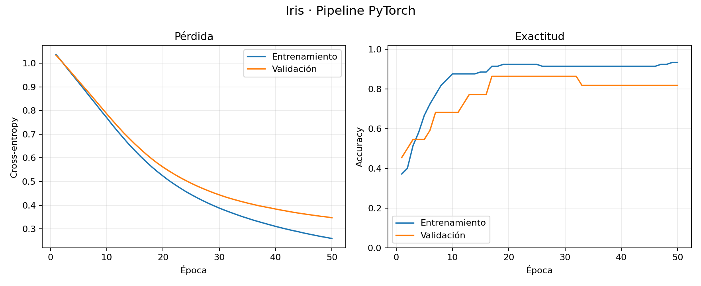

# Checkpoint 1 — Pipeline de entrenamiento, validación y clasificador base

[](https://www.python.org/)
[](https://pytorch.org/)

Primera pre-entrega del proyecto integrador de Deep Learning. Se construye un **pipeline reproducible de clasificación multiclase** usando PyTorch, no un modelo sofisticado. El objetivo es demostrar la correcta separación de datos, el bucle explícito de backpropagation, la validación independiente y el seguimiento de métricas.

> **Estado de ejecución:** validado localmente en CPU con Python 3.13.5, PyTorch 2.10.0+cpu, scikit-learn 1.8.0 y semillas fijas. Los resultados incluidos corresponden a una ejecución real, no a valores esperados o inventados.

## 1. Problema y dataset

Clasificar flores del conjunto **Iris**, utilizando 4 características (largo y ancho de sépalo y pétalo) para predecir **3 clases**. `sklearn.datasets.load_iris()` suministra 150 filas y no requiere descarga ni acceso a internet.

Se hace un *split estratificado* antes de escalar, evitando fuga de información:

| Conjunto | Muestras | Uso |
| --- | ---: | --- |
| Entrenamiento | 105 (70%) | `fit` del escalador y optimización de pesos |
| Validación | 22 (~15%) | Seguimiento por época y selección del mejor checkpoint |
| Test | 23 (~15%) | Evaluación final una única vez tras seleccionar el modelo |

`StandardScaler.fit()` se ejecuta **exclusivamente sobre train**; en validación y test solo se aplica `transform()`. El escalador se conserva en `outputs/scaler.joblib` para uso futuro.

## 2. Arquitectura y configuración

- Arquitectura: `nn.Sequential(nn.Linear(4, 16), nn.ReLU(), nn.Linear(16, 3))` en un `nn.Module`.
- Salida: tres **logits** sin Sigmoid/Softmax final: `nn.CrossEntropyLoss()` hace la transformación necesaria.
- Optimizador: `torch.optim.Adam`, `learning_rate = 0.001`.
- `epochs = 50`, `batch_size = 16`, `seed = 42`.
- Selección automática de dispositivo: **CUDA → MPS → CPU**; también admite fijarlo con `--device`.
- Reproducibilidad: semillas de Python, NumPy, PyTorch y generador de `DataLoader`, y algoritmos deterministas cuando están disponibles. La igualdad bit a bit no está garantizada entre diferentes versiones/hardware.
- Métricas por época: pérdida promedio (CrossEntropy) y Accuracy tanto en train como en validación.
- Criterio de checkpoint: mínimo `val_loss` (no máximo accuracy, no test).

## 3. Estructura del repositorio

```text
checkpoint-pytorch/
├── data/
│   └── README.md          # Iris integrado en scikit-learn
├── src/
│   ├── __init__.py
│   ├── data.py            # Carga, split, StandardScaler y DataLoaders
│   ├── model.py           # Definición de la red MLP
│   ├── train.py           # Bucle de entrenamiento, CSV y gráficos
│   ├── evaluate.py        # Validación/test con eval() y no_grad()
│   └── utils.py           # Semillas y detección de device
├── tests/
│   └── test_smoke.py      # Pruebas automatizadas
├── outputs/               # Se completa al ejecutar main.py
│   ├── metrics.csv
│   ├── curvas.png
│   ├── experiment.json
│   ├── best_model.pt      # Ignorado por Git
│   └── scaler.joblib      # Ignorado por Git
├── main.py                # Punto de entrada / CLI
├── requirements.txt
├── .gitignore
└── README.md
```

## 4. Instalación

Se recomienda **Python 3.11–3.13** con entorno virtual. Desde la carpeta raíz del proyecto:

```powershell
# Windows / PowerShell
py -3.11 -m venv .venv
.\.venv\Scripts\Activate.ps1
python -m pip install --upgrade pip
python -m pip install -r requirements.txt
```

En Linux/macOS se puede reemplazar el primer comando por `python3 -m venv .venv` y activar con `source .venv/bin/activate`.

**Uso de NVIDIA GPU (Windows/Linux):** si deseas CUDA, verifica la versión instalada con `python -c "import torch; print(torch.__version__, torch.cuda.is_available())"`. Algunas instalaciones estándar de PyTorch quedan en CPU. Para CUDA, usa el comando correspondiente a tu equipo desde el [selector oficial de instalación de PyTorch](https://pytorch.org/get-started/locally/); después instala los requisitos restantes. Este proyecto **no exige GPU**.

## 5. Ejecución

```powershell
# Entrenar con la configuración de referencia (crea outputs/)
python main.py

# Personalizar hiperparámetros y dispositivo
python main.py --epochs 50 --learning-rate 0.001 --batch-size 16 --seed 42 --device auto

# Ejecutar las pruebas automatizadas
python -m pytest -q
```

Los parámetros `--epochs`, `--learning-rate` y `--batch-size` deben ser mayores que cero. `--device` admite `auto`, `cpu`, `cuda` y `mps`, e informa cuando el hardware solicitado no está disponible. `--output-dir` permite escribir artefactos en otro directorio.

## 6. Cómo funciona el ciclo de aprendizaje

En **cada minibatch de entrenamiento**:

1. `optimizer.zero_grad(set_to_none=True)`: pone a cero los gradientes de la iteración anterior.
2. `logits = model(x)`: forward pass.
3. `loss = criterion(logits, y)`: función de pérdida.
4. `loss.backward()`: backpropagation gestionada por `torch.autograd`.
5. `optimizer.step()`: Adam actualiza los parámetros.

En **cada época**, tras el entrenamiento, se aplica `model.eval()` y `with torch.no_grad()` para medir pérdida/accuracy en validación **sin modificar pesos**. Si mejora `val_loss`, se guarda `best_model.pt`. Al terminar, se vuelve a cargar este checkpoint y se evalúa por primera y única vez sobre test.

## 7. Resultados de la ejecución verificada

**Entorno real de la prueba:** Python 3.13.5; PyTorch **2.10.0+cpu**; CPU; 50 épocas; Adam con LR 0.001; semilla 42.

| Indicador | Resultado |
| --- | ---: |
| Primera pérdida de entrenamiento | 1.0363 |
| Última pérdida de entrenamiento | **0.2596** |
| Primera pérdida de validación | 1.0334 |
| Última pérdida de validación | **0.3472** |
| Mejor época según val_loss | **50** |
| Mejor val_loss | 0.3472 |
| Test loss (mejor checkpoint) | **0.3643** |
| Test accuracy | **82.6% (19/23)** |



**Interpretación:** las pérdidas de entrenamiento y validación descienden de manera sostenida: el modelo aprende patrones relevantes. No hay una subida de `val_loss` durante estas 50 épocas que indique claramente sobreajuste por ese indicador. La diferencia entre accuracy de entrenamiento (~93%) y validación (~82%) merece seguimiento; la exactitud de validación se estanca y fluctúa porque contiene solo 22 ejemplos. El resultado de test (~82.6%) confirma que el pipeline clasifica muestras no vistas, pero **no prueba una exactitud generalizable con alta precisión estadística** debido al tamaño pequeño del conjunto.

Los valores concretos se guardan sin redondear en `outputs/metrics.csv` y `outputs/experiment.json`. Cada ejecución sobrescribe los archivos de `outputs/` indicados en este README.

## 8. Pruebas y criterios de aceptación

Las pruebas (`tests/test_smoke.py`) comprueban:

1. Tamaños y distribución de los conjuntos, y ajuste del escalador solo a train.
2. Forma de salida `(batch, 3)` y evaluación sin modificaciones en los pesos.
3. Ejecución integral de 3 épocas y existencia de todos los artefactos.
4. Igualdad de métricas entre dos entrenamientos CPU con la misma semilla.
5. Manejo de hiperparámetros y dispositivos inválidos.

Para esta pre-entrega se verificó la ejecución del entrenamiento y los resultados, junto con los tests automatizados. Puede volver a comprobarse en otra computadora ejecutando los comandos de la sección 5.

## 9. Limitaciones y próximas extensiones

- Dataset pequeño de clasificación de flores: demuestra infraestructura, no sirve como prueba de rendimiento de modelos complejos.
- Validación con solo 22 filas: sensibilidad elevada de la métrica accuracy.
- No hay optimización de hiperparámetros ni validación cruzada: si se agregan, el **test** debe permanecer aislado.
- Como siguiente etapa, puede cambiarse `src/data.py` por un dataset de texto y `src/model.py` por un clasificador adecuado manteniendo los loops de entrenamiento, validación y tracking.

## 10. Repositorio público y entrega

Este proyecto corresponde a la pre-entrega de Coderhouse de entrenamiento y validación de clasificadores base. Se entrega mediante el repositorio público:

**https://github.com/emmanuel-jaime/Coderhouse**

Para reproducir el experimento: clonar el repositorio, instalar `requirements.txt`, ejecutar `python main.py` y `python -m pytest -q`. El conjunto de datos Iris está incluido en scikit-learn; no hace falta descargar archivos.

Los resultados del experimento inicial se encuentran en `outputs/metrics.csv`, `outputs/experiment.json` y `outputs/curvas.png`. Los binarios del modelo y del escalador se generan al ejecutar el programa y no se versionan en GitHub.

> Nota: El gráfico y las métricas son de una corrida real CPU PyTorch 2.10.0+cpu de 50 épocas; la ejecución puede variar entre versiones y hardware.
