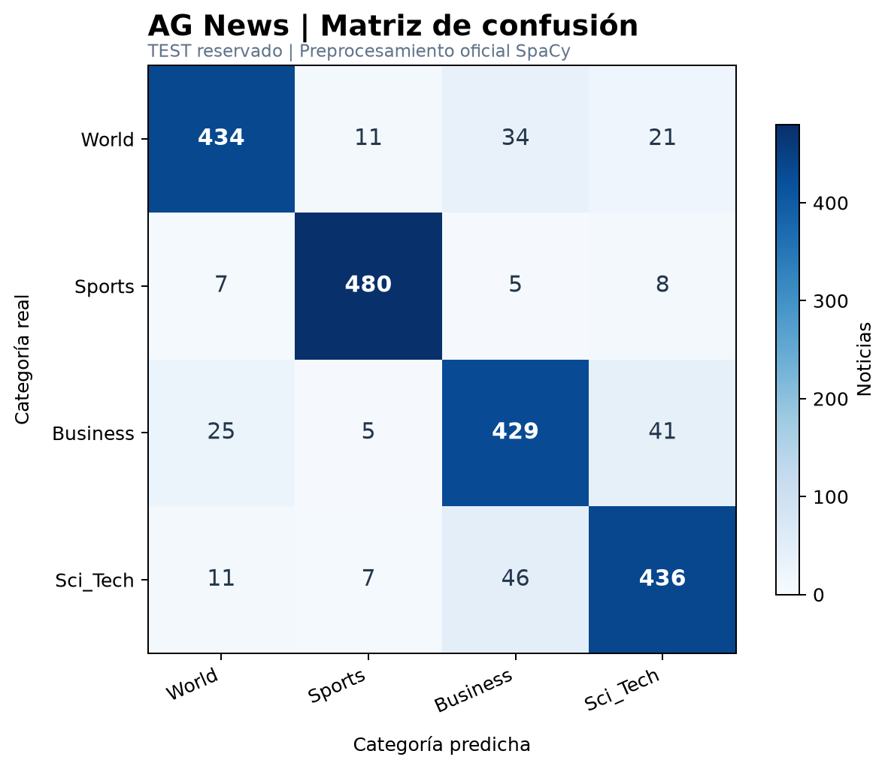

# Módulo 3 — Clasificador supervisado con TF-IDF

**Data Science III · Coderhouse · Pre-entrega 3**

Clasificador de noticias de **AG News** en cuatro categorías: `World`, `Sports`, `Business` y `Sci_Tech`.

## Objetivo y enfoque

Convertir noticias en vectores **TF-IDF** y predecir su categoría mediante **Regresión Logística**. Se reutilizan la limpieza, la tokenización y la lematización con SpaCy del Módulo 2.

Se eligió Regresión Logística como *baseline* por su eficiencia con matrices dispersas, facilidad de reproducción y buen rendimiento en clasificación de texto. Servirá de referencia para comparar los modelos del próximo módulo.

## Metodología

1. **Datos:** 8.000 noticias de entrenamiento y 2.000 de test, con los splits oficiales de la cátedra.
2. **Preprocesamiento:** normalización, limpieza de HTML y URLs, eliminación de ruido, lematización con `en_core_web_sm` y filtrado de stop-words, conservando negaciones.
3. **Validación:** división estratificada del train (80/20; semilla 42) para comparar variantes de `max_features` y `ngram_range`.
4. **Vectorización y modelo:** `TfidfVectorizer` con `min_df=2`, `sublinear_tf=True` y `norm="l2"`; `LogisticRegression(C=2.0, max_iter=1200, solver="lbfgs")`.
5. **Evaluación:** selección por F1 macro de validación; reentrenamiento con todo el train y evaluación final en test con `classification_report` y matriz de confusión.

**Sin data leakage:** el vectorizador utiliza `fit_transform()` únicamente en entrenamiento; para validación y test se utiliza `transform()`. El test no participa en la elección de hiperparámetros.

## Experimentos y resultados

| Configuración | `max_features` | `ngram_range` | F1 macro (validación) |
|---|---:|---|---:|
| A: unigramas | 5.000 | `(1, 1)` | 0,8878 |
| **B: unigramas + bigramas** | **10.000** | **`(1, 2)`** | **0,8910** |
| C: unigramas + bigramas | 20.000 | `(1, 2)` | 0,8897 |

**Modelo elegido:** configuración B.

| Métrica final (test) | Resultado |
|---|---:|
| Accuracy | **88,95 %** |
| F1 macro | **0,8896** |
| Noticias evaluadas | **2.000** |

**Por categoría:** `Sports` obtuvo el mejor F1 (0,9571); `Business`, el menor (0,8462) y el recall más bajo (85,8 %). La confusión más frecuente fue `Sci_Tech → Business` (46 noticias).



Detalles: [análisis](docs/analisis.md) · [reporte de clasificación](docs/classification_report.txt) · [comparación de configuraciones](docs/comparacion_validacion.csv).

## Ejecución local

Se necesita Python y los archivos **`ag_news_train.csv`** y **`ag_news_test.csv`** proporcionados por la cátedra, dentro de una carpeta local `data/`. Los datasets no se publican en el repositorio.

Desde `modulo-3-clasificador-tfidf/`:

```powershell
python -m pip install -r requirements.txt
python -m spacy download en_core_web_sm
python -m unittest discover -s tests -v
python main.py --mode spacy --export-docs
```

El script guarda resultados intermedios en `outputs/` (excluido de Git) y actualiza la evidencia definitiva en `docs/`.

Para probar una predicción adicional:

```powershell
python main.py --mode spacy --predict-text "The company announced record quarterly revenue"
```

## Archivos principales

- `main.py`: validación, TF-IDF, entrenamiento, evaluación y gráficos.
- `preprocessing.py`: limpieza y lematización reutilizadas del Módulo 2.
- `tests/test_pipeline.py`: 8 pruebas automatizadas.
- `docs/`: resultados oficiales y matriz de confusión.
- `requirements.txt`: dependencias del proyecto.

**Nota:** el modo `fallback` no realiza lematización oficial y no corresponde a los resultados definitivos publicados.
